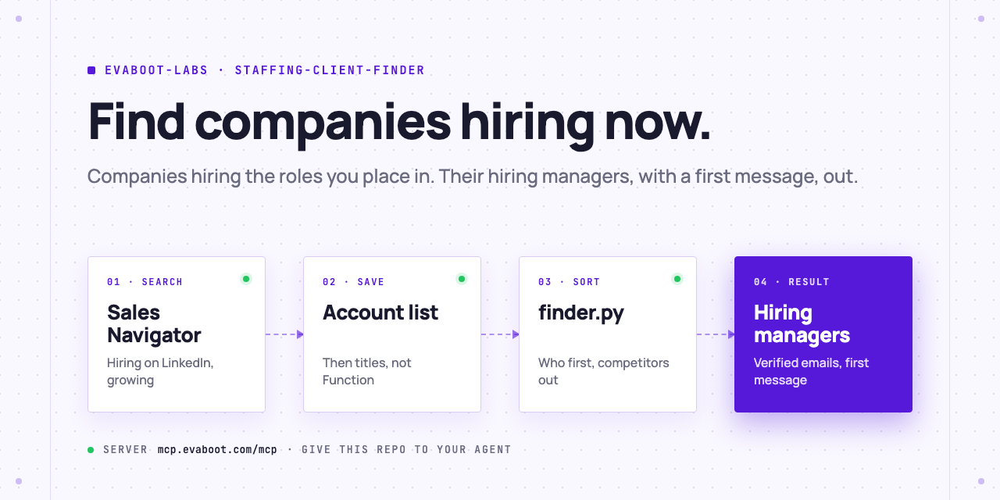

<picture>
  <source media="(prefers-color-scheme: dark)" srcset=".github/assets/banner-dark.png">
  
</picture>

# Staffing client finder

Your AI agent finds clients for your staffing or recruiting agency: it runs a Sales Navigator account search for companies that are hiring now, saves them as an account list, exports the hiring managers and talent leaders inside it with verified emails, and tells you who to contact first at each company, with a first message built on the company's hiring signal. You do the outreach.

[](AGENTS.md)
[](https://evaboot.com/mcp)
[](LICENSE)

## Set it up in one prompt

Paste this into Claude Code, Codex or Cursor:

```text
Clone https://github.com/evaboot-labs/staffing-client-finder, read AGENTS.md and follow the skill. Find companies hiring the roles I place, and their hiring managers.
```

<details>
<summary>Or install the skill</summary>

Claude Code:

```text
/plugin marketplace add evaboot-labs/staffing-client-finder
/plugin install staffing-client-finder@evaboot-labs-staffing-client-finder
```

Codex, Cursor and other agents:

```bash
npx skills add evaboot-labs/staffing-client-finder
```

</details>

## How it works

**1. Search companies, not people.** Your agent writes your desk into [`CLIENTS.md`](CLIENTS.md) and builds a Sales Navigator account search with Evaboot: headquarters, industry, size, Hiring on LinkedIn, headcount growth of 10% or more. In our test (UK software companies, 51 to 500 people) that is 375 companies hiring, 132 of them also growing.

**2. Then the people who buy.** The first 25 companies go into an account list, and `finder.py people-url` searches inside it by title: engineering leaders (the hiring managers) and talent leaders. No Seniority or Function filter: LinkedIn guesses those. Our list held 141 people.

**3. Sort, then write.** `finder.py sort` keeps the right titles at companies inside your filters, drops recruiting businesses (they are competitors), marks one hiring manager and one talent leader to contact first per company, and drafts a message from the export's own numbers.

```text
$ python3 finder.py sort data/leads.json
| yes | yes | hiring manager | VP of Engineering | Attio      | 58% | 90 | safe    |                                   |
| yes | yes | talent         | Head of Talent    | Attio      | 58% | 90 | riskier |                                   |
| no  |     | talent         | Head of Talent... | Huzzle.com | 55% | 20 | riskier | a recruiting business, a competitor |

5 of 10 people kept, at 2 companies.
```

**4. Or run it in n8n.** Every Monday, the new hiring managers and talent leaders land in a Google Sheet with their first message. No AI key needed.

## What you need

- An [Evaboot account](https://dash.evaboot.com/accounts/signup/?last_click_origin=staffing-client-finder-repo) and a Sales Navigator seat.
- An AI agent that can use an MCP server: Claude Code, Codex, Cursor, or the n8n version.
- Python 3.9+, with no packages to install.
- Cost: 1 Evaboot credit per exported person, verified email included. Saving the account list is free.

## Go further

| Page | For |
|---|---|
| [docs/connect-your-agent.md](docs/connect-your-agent.md) | The setup by hand, for each agent |
| [docs/n8n.md](docs/n8n.md) | The same finder in n8n, every Monday, into a Google Sheet |
| [CLIENTS.md](CLIENTS.md) | Your desk, the account search, the titles and the messages |

---

Agents: start at [AGENTS.md](AGENTS.md) · Built by [Evaboot](https://evaboot.com) · More workflows at [github.com/evaboot-labs](https://github.com/evaboot-labs) · [MIT license](LICENSE)
